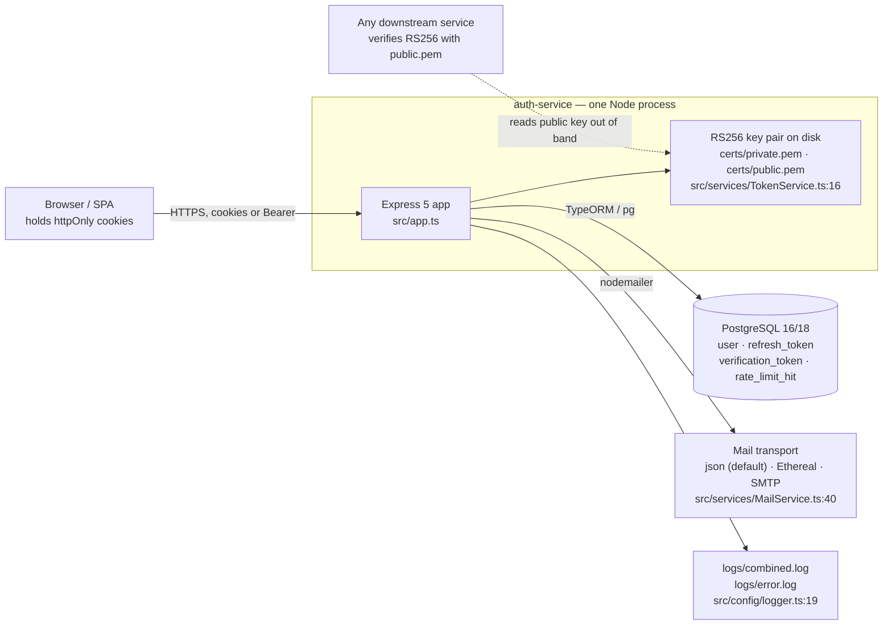
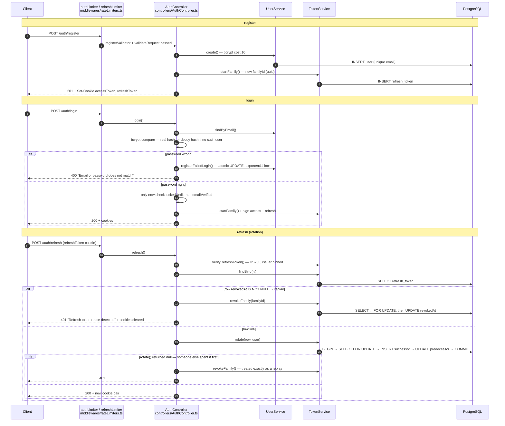
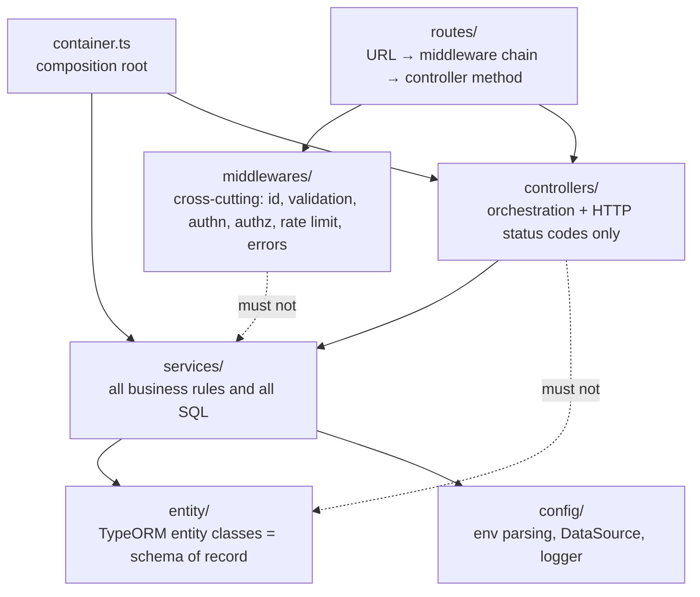
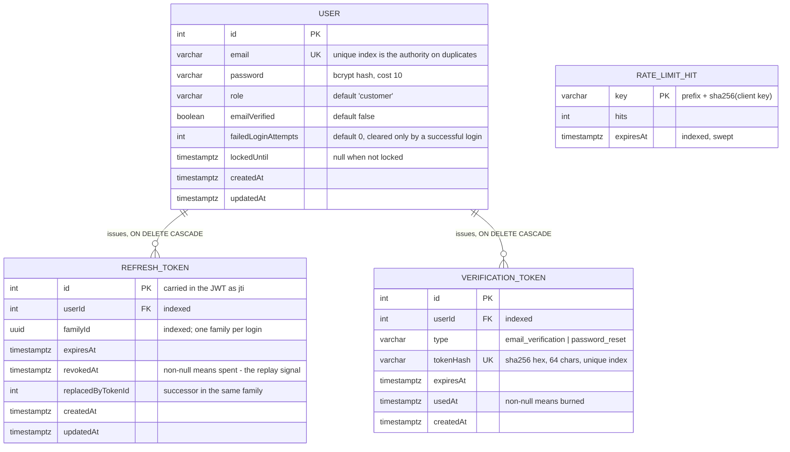
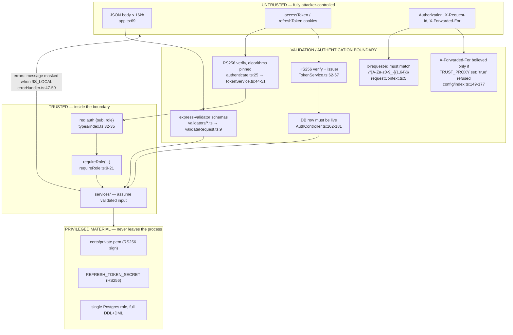
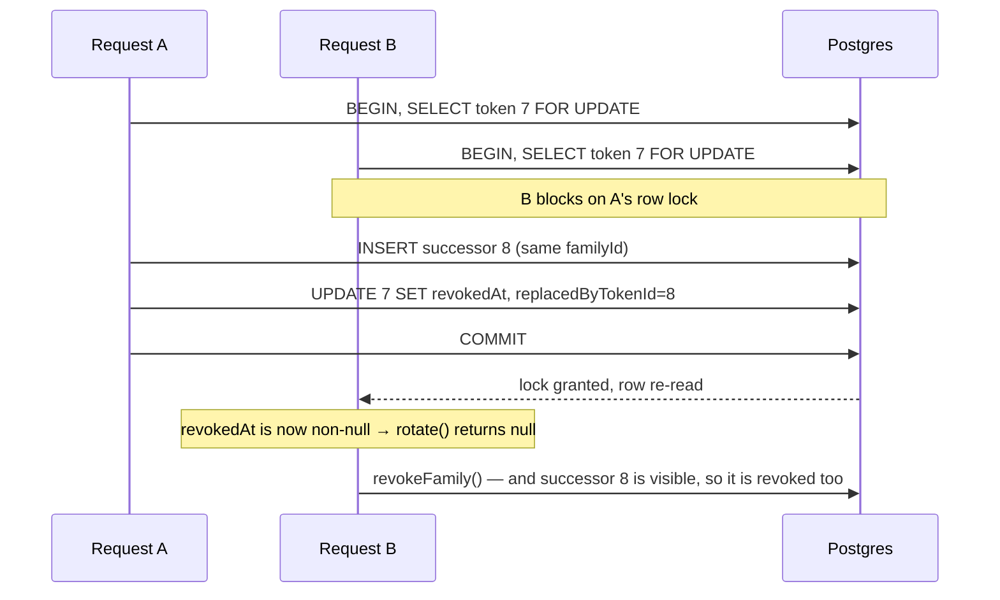

# Architecture

How this service is put together, what each part is allowed to touch, and where
it fails. Every claim below points at the file and line it came from — if a
statement here and the code disagree, the code is right and this file is a bug.

For _why_ a choice was made and what was rejected, see
[DECISIONS.md](./DECISIONS.md); this file does not repeat that reasoning, it
links to it.

---

## 1. What the service is, in one sentence

An HTTP service whose entire job is to decide whether a caller is who they say
they are, and whose authority for that decision is a row in PostgreSQL — not the
token the caller presents. The token is a pointer; the row is the truth. Almost
every design consequence in this document follows from that one sentence.

### System context



That is the whole dependency list. There is no Redis, no message queue, no
object store, no external identity provider and no telemetry backend. The
`postgres` rate-limit store exists specifically so that the shared-counter
problem is solved without adding a fifth box to this diagram
(`src/middlewares/rateLimitStore.ts:6-27`, DECISIONS.md decision 13).

The Ethereal transport (`src/services/MailService.ts:65-73`) is the one
dependency that reaches the public internet on its own initiative — it creates a
throwaway mailbox at `nodemailer.createTestAccount()`. It is opt-in and
local-only by intent.

---

## 2. The lifecycle that matters: register → login → refresh → reuse detection

Everything else in the service is scaffolding around this one path.



Where each step lives:

| Step                                      | File                                                                                  |
| ----------------------------------------- | ------------------------------------------------------------------------------------- |
| route wiring, per-route middleware order  | `src/routes/auth.ts:18-93`                                                            |
| rate limiting, two independent budgets    | `src/middlewares/rateLimiters.ts:51-85`                                               |
| body validation                           | `src/validators/*.ts` + `src/middlewares/validateRequest.ts:9-19`                     |
| register                                  | `src/controllers/AuthController.ts:47-67`                                             |
| login, including the decoy bcrypt compare | `src/controllers/AuthController.ts:69-132`, `src/services/CredentialService.ts:38-40` |
| session minting (both tokens + cookies)   | `src/controllers/AuthController.ts:36-45`, `src/utils/cookies.ts:29-42`               |
| refresh + reuse detection                 | `src/controllers/AuthController.ts:141-227`                                           |
| rotation transaction                      | `src/services/TokenService.ts:112-140`                                                |
| family / user-wide revocation             | `src/services/TokenService.ts:173-204`                                                |

Three orderings in `login` are load-bearing and are easy to "clean up" into
bugs:

- **The bcrypt compare runs on both branches** (`AuthController.ts:87-89`). An
  early return for an unknown address is a timing oracle; the decoy hash in
  `CredentialService.ts:15-18` is built from `randomBytes(32)` at import so the
  plaintext behind it exists nowhere.
- **`lockedUntil` is checked _after_ the password is proved correct**
  (`AuthController.ts:101-116`). Checked before, the 423 response is a second
  enumeration oracle.
- **`await` on the compare is not stylistic** (`CredentialService.ts:42-46`): an
  un-awaited Promise is truthy, which is how the original version accepted every
  password.

---

## 3. Module boundaries — and which ones are actually enforced



| Module         | Owns                                                                                                         | May not touch                                                                                                                 |
| -------------- | ------------------------------------------------------------------------------------------------------------ | ----------------------------------------------------------------------------------------------------------------------------- |
| `routes/`      | which middleware runs for which URL, in what order                                                           | any business rule; it holds no logic at all (`src/routes/auth.ts`)                                                            |
| `controllers/` | HTTP status codes, cookie writes, `next(err)`                                                                | SQL, repositories, hashing. It calls services only.                                                                           |
| `services/`    | every business rule, every query, every transaction                                                          | `req` / `res`. Nothing in `src/services/` imports Express.                                                                    |
| `entity/`      | the schema; migrations are generated by diffing these (`src/migrations/1787212846340-InitialSchema.ts:3-20`) | anything — they are data classes                                                                                              |
| `middlewares/` | request id, validation, authn, authz, rate limit, error rendering                                            | business rules. `authenticate` is given a `TokenService` rather than importing one (`src/middlewares/authenticate.ts:11-13`). |
| `config/`      | env parsing and fail-fast (`src/config/index.ts:23-39`), DataSource, logger                                  | everything else                                                                                                               |

**Enforced vs. conventional.** Almost all of it is conventional — TypeScript
does not stop a controller importing a repository, and there is no lint rule
that would. Four boundaries _are_ enforced by something real:

1. **Dependency direction into controllers** is enforced by construction:
   `AuthController`'s constructor takes six collaborators
   (`src/controllers/AuthController.ts:26-33`) and `src/container.ts:36-43` is
   the only place they are supplied. A controller that reached for a repository
   directly could not be unit-tested the way `tests/unit/UserService.spec.ts`
   tests services with fakes.
2. **The migration register is enforced by a test.** `src/migrations/index.ts`
   is an explicit array, and `tests/db/migrations.spec.ts` fails if a file in
   that directory is missing from it (`src/migrations/index.ts:10-12`).
3. **Entity/migration parity is enforced by a test** — the same spec asks
   TypeORM's schema builder what it would still change after the migrations run;
   the answer must be nothing.
4. **`app.ts` never calls `listen`.** The listen call is in `src/server.ts:14`.
   That split is what lets the integration suite drive the app through supertest
   without binding a port, and it is enforced by the fact that
   `src/app.ts:88` exports the app and nothing else.

The layering that is _not_ enforced, and would be the first thing to break under
maintenance: nothing prevents a new controller from calling
`AppDataSource.getRepository(...)` directly. It has not happened; there is no
mechanism that would stop it.

---

## 4. Data model



Four things in that schema are not obvious.

**Why `refresh_token` is a family rather than a row.** A single row per session
lets you revoke _that_ token. It does not let you answer "has this token been
replayed?", because once the row is gone there is nothing left to recognise.
Keeping the spent row with `revokedAt` set, and linking it forward via
`replacedByTokenId`, turns a presented-but-revoked token into positive evidence
of replay — and `familyId` is what makes the response proportionate: revoke the
whole chain descended from that login, not the whole account
(`src/entity/RefreshToken.ts:12-20`, `src/services/TokenService.ts:197-199`).
The cost of that choice is owned in DECISIONS.md decision 5.

**Why `verification_token` stores a hash and not the token.** The raw token
exists exactly twice: in the return value of `issue()` and in the email
(`src/services/VerificationTokenService.ts:21-38`). The column holds
`sha256(raw)`, so a database dump cannot be replayed against the API — the same
argument as password hashing, applied to a bearer credential
(`src/entity/VerificationToken.ts:19-23`). Issuing a new token of a type burns
any outstanding one of that type (`VerificationTokenService.ts:22-25`).

**Why `rate_limit_hit.key` is a hash with a declared width of 160.** The key is
fed from `req.ip`, which behind a trusted proxy is `X-Forwarded-For` — an
unvalidated, unbounded request header. An over-long value in a `varchar` column
is Postgres `22001` and therefore a 500 on an unauthenticated endpoint, from one
header. Hashing pins the width at 64 hex characters no matter what arrives, and
SHA-256 rather than truncation because two long values must not be able to
collide into a victim's bucket (`src/middlewares/rateLimitStore.ts:50-74`,
`src/entity/RateLimitHit.ts:17-25`).

**Why `rate_limit_hit` has no foreign key to anything.** It is keyed by client
address, not by user; the whole point is that it counts unauthenticated traffic.
Rows are reused across windows rather than inserted per window, and swept by
`sweepExpired` (`src/middlewares/rateLimitStore.ts:144-172`).

---

## 5. Trust boundaries



**Everything from the client is untrusted, including two headers people forget
are headers.** `X-Forwarded-For` decides which rate-limit bucket a caller lands
in, so it is only believed when `TRUST_PROXY` is explicitly set, and the value
`true` — which trusts every hop and therefore lets any caller name their own
address — is refused with a warning rather than accepted quietly
(`src/config/index.ts:163-174`). `X-Request-Id` is echoed into logs, so it is
accepted only as a short safe token (`src/middlewares/requestContext.ts:5,19`).

**There is exactly one privilege tier inside the process.** This is a plain
Express app with one Postgres connection and one database role; there is no
anon/authenticated split at the storage layer and no row-level security. The
only authorization primitive is `requireRole` reading `req.auth.role`, and
`req.auth` is populated only by `authenticate`
(`src/middlewares/authenticate.ts:26`). Consequently: _any route not wrapped in
`authenticate` runs unauthenticated_, and the only route currently wrapped in
`requireRole` is `GET /users` (`src/routes/users.ts:14-20`). That is a real
property of the design, not an omission to gloss over — access control here is
per-route middleware, and forgetting the middleware is the failure mode.

**What crosses back out.** A 5xx message is replaced with `"Internal server
error"` whenever `!IS_LOCAL` (`src/middlewares/errorHandler.ts:47-50`), which is
keyed off an allow-list of _local_ environment names
(`src/config/index.ts:118-119`) precisely so an unrecognised `NODE_ENV` fails
closed. The same `!IS_LOCAL` drives the `secure` cookie flag
(`src/utils/cookies.ts:22`). DECISIONS.md decision 15 owns that direction.

**Tokens live in `httpOnly; sameSite=strict` cookies**
(`src/utils/cookies.ts:19-25`), so page script cannot read them; a `Bearer`
header is also accepted for non-browser callers
(`src/middlewares/authenticate.ts:14-18`).

**Swagger UI is a trust decision, not a docs decision.** It enumerates every
endpoint and body shape, so it is mounted only when `ENABLE_API_DOCS` says so,
defaulting to local (`src/app.ts:43-59`, `src/config/index.ts:214-216`). It gets
its own relaxed CSP so the rest of the API keeps the strict one.

---

## 6. Failure modes

Only what the code does — no aspirational retries.

| Dependency / event                                      | Behaviour                                                                                                                                                                                                                                                  | Where                                       |
| ------------------------------------------------------- | ---------------------------------------------------------------------------------------------------------------------------------------------------------------------------------------------------------------------------------------------------------- | ------------------------------------------- |
| **Postgres unreachable at boot**                        | `AppDataSource.initialize()` rejects, the error is logged, `process.exit(1)`. The process does not start half-alive.                                                                                                                                       | `src/server.ts:11,69-74`                    |
| **Postgres unreachable while running**                  | Whatever query failed rejects → controller `catch` → `next(err)` → 500 with the message masked outside local. No retry, no circuit breaker, no backoff anywhere in the codebase.                                                                           | `src/middlewares/errorHandler.ts:26-50`     |
| **Postgres down, readiness probe**                      | `GET /ready` returns **503** with `{status:"not-ready", database:"down"}`; `GET /health` still returns 200 because it never touches the database. The split is deliberate: an orchestrator should pull the instance out of rotation without restarting it. | `src/routes/health.ts:7-29`                 |
| **Mail transport down or slow**                         | On registration the failure is caught, logged and **swallowed** — a mail outage must not fail a registration that already succeeded. Fails _open_. `POST /auth/resend-verification` is the recovery path.                                                  | `src/controllers/AuthController.ts:365-383` |
| **Mail transport down on `forgot-password`**            | Not swallowed — it propagates to `next(err)` and 500s. Note this differs from the register path.                                                                                                                                                           | `src/controllers/AuthController.ts:277-295` |
| **Default mail config delivers nothing**                | `MAIL_TRANSPORT=json` is the default and writes to a log and an in-memory outbox. A warning is emitted once, at the first send attempt, because in a deployment this means password reset silently does not work.                                          | `src/services/MailService.ts:44-53`         |
| **RS256 key file missing/unreadable**                   | `readKey` throws a 500 http-error — _at first use_, not at boot, because the keys are read lazily and memoised. A misconfigured deployment therefore starts successfully and 500s on the first login.                                                      | `src/services/TokenService.ts:16-26`        |
| **Rate-limit sweep fails**                              | Logged at warn and ignored; the request is not failed. Stale rows are housekeeping, a failed request is an outage. Fails _open_.                                                                                                                           | `src/middlewares/rateLimitStore.ts:154-172` |
| **Rate-limit store query fails** (postgres mode)        | `increment` rejects → express-rate-limit calls `next(err)` → 500. Fails _closed_, on an unauthenticated endpoint.                                                                                                                                          | `src/middlewares/rateLimitStore.ts:83-106`  |
| **Missing required env var**                            | Throws at import of `src/config/index.ts` before anything binds.                                                                                                                                                                                           | `src/config/index.ts:33-39`                 |
| **Weak / example `REFRESH_TOKEN_SECRET` outside local** | Refuses to start. It is an account-takeover, not a hardening nit, because the `jti` is a sequential integer.                                                                                                                                               | `src/config/index.ts:41-80`                 |
| **SIGTERM / SIGINT**                                    | Stop accepting connections, drain in-flight requests, close the pool, exit 0; a 10s timer forces exit 1 if draining stalls.                                                                                                                                | `src/server.ts:28-55`                       |
| **`uncaughtException`**                                 | Logged, then the same graceful shutdown runs. `unhandledRejection` is logged only — the process keeps serving.                                                                                                                                             | `src/server.ts:59-68`                       |
| **Headers already sent when an error surfaces**         | `errorHandler` delegates to Express rather than writing a second body.                                                                                                                                                                                     | `src/middlewares/errorHandler.ts:37-39`     |

**There are no timeouts configured anywhere.** No HTTP server timeout, no
`statement_timeout` on the pool, no `connectTimeout` on nodemailer. A slow
Postgres or a hanging SMTP server holds the request until the client gives up.
This is the largest gap in the table.

---

## 7. Concurrency

Four races were possible in this codebase. Each is prevented by pushing the
decision into a single SQL statement or a single transaction, never by
application-level locking.

### 7.1 Two refreshes of one token — `SELECT … FOR UPDATE`

`src/services/TokenService.ts:112-140`.

The controller's "is this row live?" check (`AuthController.ts:168`) is a read,
and two concurrent refreshes both pass it. Without the database picking a
winner, both rotate: the family ends up with two live successors and the replay
that should have burned it is never detected.



A conditional `UPDATE … WHERE revokedAt IS NULL` alone would not have been
enough, and the second bullet is the subtle half: the loser then revokes the
family, and it must not do so while the winner's successor is still uncommitted,
or it would revoke the rows visible at that instant and the new one would quietly
survive. Holding the lock until commit is what makes the successor visible to the
loser. `rotate()` returning `null` is handled identically to a replay
(`AuthController.ts:199-207`) — at the database the two are indistinguishable,
and guessing wrong leaves an attacker logged in.

### 7.2 Revoking a family while a rotation is in flight — the same lock as a barrier

`src/services/TokenService.ts:142-195`.

A bare `UPDATE … WHERE revokedAt IS NULL` fixes its snapshot when the statement
starts, so a successor inserted after that is not a candidate. The comment
records the measurement: a `revokeAllForUser` racing a refresh left 6 of 40 reset
passwords with a live 30-day refresh token — after the one action a user takes
because they believe they are compromised. `SELECT … FOR UPDATE` first turns it
into a barrier: the following `UPDATE` is a separate statement with a fresh
snapshot, so the committed successor is visible and gets revoked.

`ORDER BY "id"` in that SELECT (`TokenService.ts:182`) fixes the lock order, so a
family revoke and a user-wide revoke whose sets overlap queue instead of
deadlocking.

The lock is taken over the _whole_ set, not over `revokedAt IS NULL`, because
what has to be waited on is any rotation in flight — and the row it is spending
may already be spent by the time this transaction re-reads it.

### 7.3 Counting failed logins — the increment happens inside the UPDATE

`src/services/UserService.ts:85-107`.

The old shape computed `user.failedLoginAttempts + 1` in JavaScript from a row
read earlier in the request, so two failures arriving together both read 3 and
both wrote 4: the counter advanced by one instead of two, and an attacker who
sent guesses in parallel stayed under the cap indefinitely. It is now one
statement — `SET "failedLoginAttempts" = "failedLoginAttempts" + 1` with the
lock-out interval computed in the same `CASE` — so the row lock serialises it.

The same statement implements exponential backoff, doubling from
`ACCOUNT_LOCK_INITIAL_MINUTES` and capped at `ACCOUNT_LOCK_MINUTES`, so the
first lock a real user hits after mistyping costs a minute rather than fifteen.
DECISIONS.md decision 6 owns the residual DoS.

> ⚠️ **This statement has a defect.** See §9.

### 7.4 Burning a one-time token, and the rate-limit counter

`VerificationTokenService.consume` (`src/services/VerificationTokenService.ts:46-62`)
uses a plain conditional update — `UPDATE … WHERE id = $1 AND usedAt IS NULL`,
then `result.affected === 1` decides the winner. It gets away without a lock
where `rotate` could not, because burning a token _creates nothing that a
concurrent caller also has to see_.

The rate limiter needs the same property across replicas, and solves it with a
single statement that reads, decides window expiry, writes and returns
(`src/middlewares/rateLimitStore.ts:86-106`):

```sql
INSERT INTO "rate_limit_hit" ("key","hits","expiresAt")
VALUES ($1, 1, now() + ($2 || ' seconds')::interval)
ON CONFLICT ("key") DO UPDATE SET
  "hits" = CASE WHEN "rate_limit_hit"."expiresAt" <= now() THEN 1
                ELSE "rate_limit_hit"."hits" + 1 END,
  ...
RETURNING "hits","expiresAt"
```

A read-then-write here would let two replicas both see 19 and both write 20.

Registration duplicate-email is the fifth, cheapest case: the `findOne` in
`UserService.create` (`src/services/UserService.ts:19-22`) is a courtesy check,
and the unique index is the authority — `23505` is caught and turned into a 400
(`src/services/UserService.ts:34-42`, DECISIONS.md decision 7).

---

## 8. What this architecture does not do

- **It does not survive horizontal scaling with its default settings.** The
  rate-limit store defaults to `memory`, which counts per process, so N replicas
  mean N times the budget — and a rolling deploy makes a single-instance service
  briefly two. `RATE_LIMIT_STORE=postgres` fixes it and is the only piece of
  in-process state that has an out-of-process alternative
  (`src/middlewares/rateLimitStore.ts:175-188`).
- **Other in-process state that does not replicate:** the memoised RS256 keys
  (`TokenService.ts:13-14`), the memoised nodemailer transport
  (`MailService.ts:32`), the in-memory `outbox` capped at 100 messages
  (`MailService.ts:17,25`), and `PostgresRateLimitStore.lastSweep`
  (`rateLimitStore.ts:44`) — which means the sweep runs once per window _per
  process per limiter_, not globally.
- **No background jobs at all.** Nothing expires or deletes `refresh_token` or
  `verification_token` rows; they accumulate forever. The only cleanup in the
  service is the rate-limit sweep, and it is piggybacked on request traffic
  (`rateLimitStore.ts:154-158`), so a service with no traffic never sweeps.
- **Logs go to local files and stdout, not to a log service**
  (`src/config/logger.ts:19-32`). On more than one replica they do not
  aggregate, and there is no rotation.
- **No distributed tracing, no metrics.** `x-request-id` correlates a single
  request within one process (`requestContext.ts:13-35`); nothing exports a
  counter or a histogram.
- **No "sign out everywhere" endpoint.** `logout` revokes one family
  (`AuthController.ts:235-254`); only a password reset revokes all of a user's
  tokens (`AuthController.ts:317`).
- **No refresh-token binding to a device or IP.** A stolen refresh cookie is
  usable from anywhere until it is rotated or the family is revoked; reuse
  detection catches the _second_ user of a token, not the first.
- **One database role with full rights.** No read replica, no least-privilege
  split, no row-level security. Column-level protection is a `select` list in
  the repository call (`src/services/UserService.ts:53-58`), which is
  application-level, not database-level.
- **The Docker image is a development image** (`docker/dev/Dockerfile`, run by
  `docker-compose.yml:25-51`) — sources under nodemon with dev dependencies.
  There is no production image.
- **Access-token revocation is not possible.** An access token is valid for its
  full `ACCESS_TOKEN_EXPIRY` (default 1h) from the moment it is signed; nothing
  checks a database row on `authenticate` (`src/middlewares/authenticate.ts:24-30`).
  Revoking a family stops the _next_ refresh, not the current access token. That
  is the deliberate trade in DECISIONS.md decision 3 — it is what makes the
  RS256 token verifiable by a downstream service with no call back here.

---

## 9. Known defects found while writing this document

**`registerFailedLogin` freezes the lockout counter after ~1,028 failures, and
returns 500 from then on.**

`src/services/UserService.ts:93` computes the backoff as:

```sql
LEAST($3::numeric * power(2, "failedLoginAttempts" + 1 - $2)::numeric, $4::numeric)
```

`power(2, …)` resolves to the `double precision` overload, so the `::numeric`
cast happens _after_ the exponentiation, and `LEAST` does not short-circuit —
the cap is applied to a value that has already been computed. Reproduced against
PostgreSQL 18.4 with the exact statement from that file and the default
`MAX_FAILED_LOGIN_ATTEMPTS=5`:

```
failedLoginAttempts = 1027 → OK
failedLoginAttempts = 1028 → ERROR: value out of range: overflow
                              counter frozen at 1028, lockedUntil unchanged
```

Consequences, in order of severity:

1. **The per-account brute-force defence turns itself off.** The whole `UPDATE`
   aborts, so `failedLoginAttempts` stops climbing and `lockedUntil` stops being
   extended. Once the last lock expires the account can never be locked again —
   only a successful login resets the counter
   (`src/services/UserService.ts:109-115`). The attacker who caused it is the
   one who benefits from it.
2. **`POST /auth/login` returns 500 for that email** on any wrong password
   (`AuthController.ts:93` → `catch` → `next(err)`), where every other address
   returns 400. That is an account-enumeration oracle, which is the exact class
   of leak `CREDENTIALS_REJECTED` and the decoy bcrypt compare exist to close.
3. Reaching 1,028 needs 1,028 wrong-password requests against one address. The
   per-IP limiter (20 per 15 minutes by default) makes that ~13 hours from one
   address, or minutes from a few dozen — and the lockout does **not** stop the
   counter climbing, because `login` runs `registerFailedLogin` before it ever
   looks at `lockedUntil` (`AuthController.ts:91-99`).

**Fixed in `57a3dc9`**, after this document surfaced it. The exponent is now
capped rather than the result — `power(2, LEAST("failedLoginAttempts" + 1 - $2, 20))`
in `src/services/UserService.ts:107`. 2^20 initial minutes is about two years, so
`ACCOUNT_LOCK_MINUTES` remains the thing that bounds the wait. Covered by
`tests/db/account-lockout.spec.ts`, which drives the real statement at the
boundary pair 1028/1029 with the counter pre-set, plus a case asserting the
ordinary doubling below the cap so the clamp cannot quietly flatten it.

Worth recording how it was found: writing this section required explaining what
`LEAST` actually bounds, and the explanation did not survive being written down.

**A second, lower-severity mismatch:** the `accessToken` cookie's `maxAge` is
hard-coded to one hour (`src/utils/cookies.ts:27,36`) while the token's own
lifetime is `ACCESS_TOKEN_EXPIRY` (`src/config/index.ts:202`). They agree at the
default and diverge the moment anyone changes the variable — set it to `7d` and
the browser discards a still-valid token after an hour; set it to `15m` and the
cookie outlives the token by 45 minutes. One lifetime, two sources of truth.
