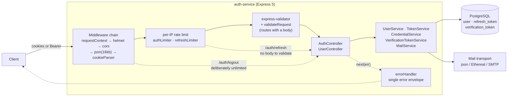
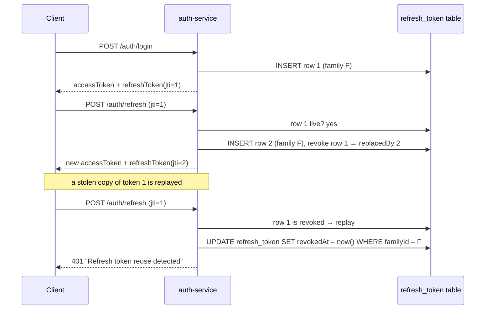

# auth-service

A standalone authentication service in TypeScript: registration and login, RS256
access tokens, rotating refresh tokens with reuse detection, password reset,
email verification and role-based access control, backed by PostgreSQL.

## Run the tests first — the database comes with the repository

93 tests, and **the repository brings its own PostgreSQL** — no Docker, no
system package, no account, nothing to install:

```bash
npm install
npm run keys:generate
cp .env.example .env.test          # then set DB_NAME=authservice_test
npm run db:local                   # own terminal; wait for "ready to accept connections"
npm run test:ci                    # 93 tests, ~35s
```

`npm run db:local` starts a real platform PostgreSQL binary out of `.postgres/`
via `embedded-postgres` and creates both databases. Ctrl-C is the whole
lifecycle. The suite is mostly integration tests driven by supertest, so what it
proves is the HTTP behaviour: refresh-token rotation, reuse detection revoking a
family while leaving a sibling session alive, the login timing oracle staying
closed, the lockout schedule, RBAC, and the rate-limit store shared across two
independent Express apps.

- API documentation (Swagger UI): `/api-docs` when the service is running
  (served in dev/test by default; set `ENABLE_API_DOCS=true` to expose it elsewhere)
- Design rationale: [DECISIONS.md](./DECISIONS.md)
- CI (`.github/workflows/ci.yml`) runs lint, format, typecheck, build and the
  suite against a `postgres` service container — see "Notes and limitations"
  for what has and has not actually been executed.

## Architecture

The full system-architecture document — trust boundaries, the data model,
concurrency, failure modes and what this design deliberately does not do — is
[ARCHITECTURE.md](./ARCHITECTURE.md). The diagram below is the shape of one
request; that file explains the rest.



## How it works

`src/server.ts` opens the TypeORM connection and starts the HTTP server;
`src/app.ts` builds the Express application and nothing else, which is what lets
the integration tests drive the app with supertest without binding a port.
`src/container.ts` is the composition root: it constructs every service once and
injects the repositories, so the controllers and services can be unit tested with
plain fakes. A request passes through `requestContext` (correlation id and a
winston child logger), `helmet`, a CORS allowlist, a 16 kB JSON body cap and
`cookieParser`, then through a per-IP rate limiter and, if the route takes a
body, the express-validator schema for that route, before it reaches a
controller in `src/controllers/`.

Two routes take a different path and it is worth knowing which. `POST
/auth/refresh` has no body to validate — its only input is the `refreshToken`
cookie, whose signature the controller checks before using it — so it is
rate-limited but has no validator, and it uses `refreshLimiter` rather than
`authLimiter` so that machine-driven refresh traffic and human login traffic
cannot exhaust each other's budget. `POST /auth/logout` has neither: it revokes
rather than mints, an unusable cookie costs one signature check and no query,
and refusing a logout would leave alive the session the user asked to end.
Controllers hold only orchestration; the work lives in `src/services/`, and every
failure is thrown as an `http-errors` object and rendered by the single
`errorHandler` in `src/middlewares/errorHandler.ts`. Passwords are hashed with
bcrypt in `src/services/CredentialService.ts` (cost 10) and the plaintext is
never logged. Access tokens are signed RS256 with a key pair generated by
`npm run keys:generate`; refresh tokens are signed HS256 and, crucially, are
only accepted if the row they point at in the database is still live.

## Where this came from

I built the first version of this between 31 October and 11 November 2025,
learning TypeScript backend work. In August 2026 I came back and went through it
properly. The schema had no migrations at all — it was built by TypeORM's
`synchronize`, which is not something you can run at a production database. The
rate limiter keyed on `X-Forwarded-For` with `trust proxy` set and no proxy in
front of it, so anyone who could set a header could buy a fresh budget; and the
hardening switches were keyed off "is this production" rather than "is this
local", so an unfamiliar `NODE_ENV` silently got the weak behaviour. Login
answered faster for an unknown address than for a real one, which is an account
enumeration oracle, and two read-then-write paths could race. The Docker image
carried the JWT signing key and the env files. `npm audit` reported 19
advisories, one critical. `/auth/refresh` had no rate limit while `/auth/login`
did. And the setup path this README documents did not work: `.env.example` lists
every optional variable with an empty value so a reader can see the name and the
default, dotenv turns those into `""`, and `??` does not treat an empty string as
absent — so `cp .env.example .env.dev` handed `expiresIn: ""` to jsonwebtoken and
500'd every login. `tests/unit/env-example.spec.ts` now loads the committed file
and asserts the defaults survive it.

All of it is fixed, each with a test; the reasoning for each choice is a numbered
decision in [DECISIONS.md](./DECISIONS.md). What is still unverified is listed at
the bottom of this file rather than left for you to discover.

## Refresh tokens: rotation and reuse detection

A refresh token JWT carries the id of its own row in the `refresh_token` table as
the `jti`. Rows issued from a single login share a `familyId`. `POST /auth/refresh`
burns the presented row (`revokedAt` set, `replacedByTokenId` pointing at its
successor) and issues the next token in the same family. If a token that has
already been rotated is presented again, one of two things is true: an attacker
stole it, or the legitimate client is replaying an old copy. The service cannot
tell which, so it revokes the whole family and forces a fresh login.



Both branches are covered in `tests/users/refresh.spec.ts`, including the
assertion that a _different_ session of the same user is left untouched.

## API

All bodies and responses are JSON. Errors always use the same envelope:

```json
{
  "errors": [
    {
      "type": "BadRequestError",
      "msg": "...",
      "path": "",
      "location": "",
      "requestId": "..."
    }
  ]
}
```

Access and refresh tokens are set as `httpOnly`, `SameSite=Strict` cookies.
`secure` is set in every environment except `dev`, `development` and `test` — an
allow-list of local names rather than of production ones, so an unfamiliar
`NODE_ENV` gets the strict behaviour instead of quietly dropping the flag.
`/auth/self` and `/users` also accept `Authorization: Bearer <accessToken>`.

| Method | Path                        | Auth                       | Request body                               | Success                                                                  | Failure                                                                          |
| ------ | --------------------------- | -------------------------- | ------------------------------------------ | ------------------------------------------------------------------------ | -------------------------------------------------------------------------------- |
| POST   | `/auth/register`            | none                       | `{ firstName, lastName, email, password }` | `201 { userId }` + cookies                                               | `400` validation / email taken, `429`                                            |
| POST   | `/auth/login`               | none                       | `{ email, password }`                      | `200 { id }` + cookies                                                   | `400` bad credentials, `403` unverified email (when gated), `423` locked¹, `429` |
| POST   | `/auth/refresh`             | `refreshToken` cookie      | none                                       | `200 { id }` + new cookies                                               | `401` missing / invalid / expired / replayed, `429`                              |
| POST   | `/auth/logout`              | `refreshToken` cookie      | none                                       | `200 { success: true }`                                                  | —                                                                                |
| GET    | `/auth/self`                | access token               | none                                       | `200 { id, firstName, lastName, email, role, emailVerified, createdAt }` | `401`                                                                            |
| POST   | `/auth/forgot-password`     | none                       | `{ email }`                                | `202 { success: true }`                                                  | `400` validation                                                                 |
| POST   | `/auth/reset-password`      | none                       | `{ token, password }`                      | `200 { success: true }`                                                  | `400` invalid / used / expired                                                   |
| POST   | `/auth/verify-email`        | none                       | `{ token }`                                | `200 { success: true }`                                                  | `400` invalid / used / expired, `429`                                            |
| POST   | `/auth/resend-verification` | none                       | `{ email }`                                | `202 { success: true }`                                                  | `400` validation                                                                 |
| GET    | `/users`                    | access token, role `admin` | none                                       | `200 { users: [...] }`                                                   | `401`, `403`                                                                     |
| GET    | `/health`                   | none                       | none                                       | `200 { status: "ok", uptimeSeconds }`                                    | —                                                                                |
| GET    | `/ready`                    | none                       | none                                       | `200 { status: "ready", database: "up" }`                                | `503` database unreachable                                                       |
| GET    | `/api-docs`                 | none                       | none                                       | Swagger UI (dev/test only unless `ENABLE_API_DOCS=true`)                 | `404` when disabled                                                              |

`/auth/forgot-password` and `/auth/resend-verification` answer `202` whether or
not the address exists, so they cannot be used to enumerate accounts.

¹ `423` is returned only to a caller who supplied the **correct** password for a
locked account. A wrong password gets the same `400` whether the address exists,
does not exist, or is locked — otherwise `423` would answer "does this account
exist?" for anyone willing to send five failures. For the same reason a login
for an unknown address still performs a bcrypt comparison, so it takes the same
time as one for a real account.

Login is also protected by a per-account lockout that starts at one minute and
doubles with each further failure up to fifteen, rather than a flat fifteen —
see [DECISIONS.md](./DECISIONS.md) decision 6, which is candid about what that
does and does not fix.

Every response carries an `x-request-id` header. Supply your own and it is
echoed back and used in the logs for that request.

## Setup

### Prerequisites

- Node.js 24 (`.nvmrc`; verified on Node 24.16.0 / npm 11.13.0)
- PostgreSQL 14 or newer, or Docker

### With Docker Compose

```bash
docker compose up --build
# API   http://localhost:5501
# Docs  http://localhost:5501/api-docs
```

Compose starts PostgreSQL and waits for its healthcheck. The image's `CMD` then
generates the key pair on first boot, runs `npm run migration:run` to create the
schema, and only then starts the service with nodemon against a bind mount. A
failed migration stops the container rather than starting the service against a
half-built schema.

### Without Docker

```bash
npm install
npm run keys:generate          # writes certs/private.pem and certs/public.pem (gitignored)
cp .env.example .env.dev       # the database values are already filled in
cp .env.example .env.test      # then change DB_NAME to authservice_test
npm run db:local               # in its own terminal - see below
npm run migration:run          # creates the schema
npm run dev                    # http://localhost:5501
```

The database has to exist and be migrated before the service starts:
`synchronize` is on only under `NODE_ENV=test`, so nothing builds the schema
implicitly.

### A database with no prerequisites

If PostgreSQL is not installed, `npm run db:local` starts a real one - a
platform PostgreSQL binary shipped by `embedded-postgres`, run out of
`.postgres/` in this repository. No Docker, no system package, nothing to
install or pay for. It also creates `authservice_dev` and `authservice_test`,
which are the databases `.env.example` points at.

It runs in the foreground, so give it its own terminal; Ctrl-C stops it and the
data stays in `.postgres/` until that directory is deleted. If port 5432 is
taken, `DB_PORT=5433 npm run db:local` and set `DB_PORT` to match in
`.env.dev` and `.env.test`.

Already have PostgreSQL? Ignore all of this and point `.env.dev` at it.

### Database migrations

The schema lives in `src/migrations/`, registered in `src/migrations/index.ts`.

| Script                                                | What it does                                                                |
| ----------------------------------------------------- | --------------------------------------------------------------------------- |
| `npm run migration:run`                               | Applies every pending migration. Idempotent — a second run is a no-op.      |
| `npm run migration:revert`                            | Reverts the last applied migration.                                         |
| `npm run migration:show`                              | Lists migrations and whether each is applied.                               |
| `npm run migration:generate -- src/migrations/<Name>` | Diffs the entities against the current database and writes a new migration. |
| `npm run migration:run:built`                         | The same as `migration:run`, against compiled `build/` output.              |
| `npm run migration:revert:built`                      | The same as `migration:revert`, against compiled `build/` output.           |

The first four run the TypeScript sources through `ts-node`'s ESM loader —
`tsx` cannot be used here because it does not emit the decorator metadata
TypeORM reads the column types from. The `:built` pair run plain `node` against
`build/`, which is the path a deployment takes: it needs no dev dependencies.

After generating a migration, add its class to the array in
`src/migrations/index.ts`. `tests/db/migrations.spec.ts` fails if you forget.

Adding a column to an entity without writing a migration is caught by the same
suite: it runs the migrations on an empty database and asserts TypeORM's schema
builder has no remaining DDL to apply, so the migrations and the entities cannot
drift apart silently.

### Configuration

Configuration is read from `.env.$NODE_ENV` — `.env.dev`, `.env.test`,
`.env.prod` — via `src/config/index.ts`. Real environment variables always take
precedence over the file, which is why the Compose and CI setups do not ship
one. `DB_HOST`, `DB_PORT`, `DB_USERNAME`, `DB_PASSWORD`, `DB_NAME` and
`REFRESH_TOKEN_SECRET` are mandatory: the process refuses to start without them.
Outside `dev`/`development`/`test` it also refuses to start if
`REFRESH_TOKEN_SECRET` is under 32 characters or is one of the example values in
this repository. Every variable is listed and commented in
[.env.example](./.env.example).

`npm run dev` watches `src/` and `tests/` only, so editing `.env.dev` while it is
running has no effect until you restart it. nodemon is configured with
`exitcrash`, so a fatal startup error - a bad environment value, an unreachable
database - stops it instead of leaving it idling.

### Rate limiting across replicas

`express-rate-limit`'s default store keeps its counters in the process. With two
replicas an attacker gets twice the budget, so a limit of 20 is really 40 — and
a rolling deploy means even a single-instance service is periodically two.

`RATE_LIMIT_STORE` selects the store:

- `memory` (default) — the in-process store. Correct for one instance, needs
  nothing.
- `postgres` — counters in the `rate_limit_hit` table, shared by every replica
  connected to the same database. No extra infrastructure: it reuses the
  database the service already requires.

The Postgres store does its whole increment in one `INSERT ... ON CONFLICT DO
UPDATE ... RETURNING`, so replicas incrementing the same key serialise on the
row lock rather than racing a read-then-write. Expired rows are swept at most
once per window by whichever request notices, so there is no scheduler to run.

Writing a different store — Redis, Memcached, anything — means implementing
`express-rate-limit`'s `Store` interface (`increment`, `decrement`, `resetKey`,
optionally `get`, `resetAll` and `init`) and returning it from
`createRateLimitStore` in `src/middlewares/rateLimitStore.ts`. One thing to know
before you do: express-rate-limit does **not** prepend `store.prefix` to the
keys it passes in — it only reads that field for its own double-count check — so
the store must apply the prefix itself, or every limiter shares one budget.

`tests/db/rate-limit-store.spec.ts` proves the sharing works by running two
independent Express apps with two independent store objects and asserting that
spending the budget on the first makes the second refuse.

### Email

`MAIL_TRANSPORT` selects how password-reset and verification mail is delivered.
All three options are free:

- `json` (default) — nothing is sent; the message is logged and kept in an
  in-memory outbox that the tests assert against.
- `ethereal` — [Ethereal](https://ethereal.email) creates a throwaway mailbox on
  demand with no signup, and the log line for each message contains a preview
  URL. Nothing is delivered to real inboxes.
- `smtp` — any SMTP server, via `SMTP_HOST`, `SMTP_PORT`, `SMTP_SECURE`,
  `SMTP_USER`, `SMTP_PASSWORD`.

The default is `json`, which means **password reset and email verification send
nothing to anyone** until you change it. That is right for local work and wrong
everywhere else, so the service logs a warning the first time it tries to send
mail under the default transport.

The `json` and `ethereal` transports have both been run end to end from this
repository; `smtp` has not. See "Notes and limitations".

The Ethereal preview URL opens the message itself, so for a password reset it is
a working reset link. It is written to the log only in local environments.

## Running the tests

The suite is mostly integration tests driven by supertest, so **it needs a real
PostgreSQL**. It drops and re-creates the schema between test cases, so point it
at a throwaway database — `npm run db:local` gives you one with nothing
installed, as at the top of this file.

```bash
cp .env.example .env.test      # DB_NAME should be a scratch database
npm run keys:generate
npm run test:ci                # single run, CI-safe: 93 tests
npm run test:watch             # watch mode for local work
```

`npm test` and `npm run test:ci` both run once and exit. `npm run test:watch` is
the only watching script — the previous `test` script passed `--watch` and hung
forever in CI.

Full local verification:

```bash
npm run lint:check
npm run typecheck
npm run build
npm run test:ci
```

## Observability

Traces and metrics via [OpenTelemetry](https://opentelemetry.io/) (Apache-2.0),
**exporting to the console by default** — no collector, no account, nothing to
pay for.

```bash
npm run dev                                            # traces + metrics on stdout
OTEL_EXPORTER_OTLP_ENDPOINT=http://localhost:4318 npm run dev   # to a collector
OTEL_TRACES_EXPORTER=none OTEL_METRICS_EXPORTER=none npm run dev  # off
```

Every variable is OpenTelemetry's own and is listed in
[.env.example](./.env.example). Under `NODE_ENV=test` everything defaults to
`none`, so the suite does not print a span apiece.

The structured log already says how long a request took. Tracing is only here
where it says how long doing **what**, which on this service is three places:

| span                                                   | why it exists                                                                                                                                                                                                                                                         |
| ------------------------------------------------------ | --------------------------------------------------------------------------------------------------------------------------------------------------------------------------------------------------------------------------------------------------------------------- |
| `credential.hash` / `credential.compare`               | bcrypt at cost 10, ~60ms, deliberately. The largest single cost of a login by an order of magnitude, and the number to look at before anyone proposes lowering the cost factor.                                                                                       |
| `token.start_family` / `token.rotate` / `token.revoke` | the refresh path writes two rows inside a transaction that takes a pessimistic row lock. `token.rotate.contended` distinguishes "slow because it waited on a concurrent rotation" from "slow because the database is slow" — indistinguishable in a request duration. |
| `mail.send`                                            | an outbound call on the registration and reset paths, wrapped in a `try/catch` that deliberately swallows failures. The span is the only surviving evidence that a verification email never went.                                                                     |

Nothing else is traced. A span around one indexed `SELECT` would add noise to
every trace and tell nobody anything.

Two deliberate omissions, both security rather than taste. `credential.compare`
is the span name for **both** the real comparison and
`compareAgainstAbsentUser`, with identical attributes: that method exists so a
login for an address with no account is indistinguishable from one for an
address that has one, and a span naming the branch would put the answer the
timing oracle used to give straight into telemetry, which leaves the box.
`mail.send` carries the transport and **not** the recipient, for the same
reason.

Three metrics: `http.server.request.duration` by route and outcome,
`auth.rate_limit.rejections` by which budget refused, and
`auth.token.reuse_detected` split into `replay` and `concurrent` — the service
answers both the same way and cannot tell them apart, but an operator can act
on the difference. The `http.route` attribute is a closed set derived from the
matched route, never from the caller's URL.

Every log line carries `traceId` and `spanId`, and `x-trace-id` comes back on
the response beside the `x-request-id` that was already there.

**What it costs**, from `npm run bench:telemetry`, 2000 `GET /health` per
configuration (that route because it does no bcrypt and touches no database, so
the overhead is resolvable rather than lost inside a 60ms hash):

| configuration               | p50     | p95     | mean    |
| --------------------------- | ------- | ------- | ------- |
| off                         | 0.684ms | 1.241ms | 0.772ms |
| console (default)           | 0.783ms | 1.533ms | 0.958ms |
| console, 1s metric interval | 0.831ms | 1.357ms | 0.945ms |

**+0.099ms at p50** on the cheapest route this service serves — and roughly
0.16% of a login, which spends ~60ms in bcrypt by design.

Instrumentation is hand-written rather than
`@opentelemetry/auto-instrumentations-node`; the reasoning is in
[DECISIONS.md](./DECISIONS.md) decision 18 and at the top of
`src/config/telemetry.ts`.

## Project layout

```
src/
  app.ts               Express app assembly (no listen call)
  server.ts            connection, listen, graceful shutdown
  container.ts         composition root
  config/              env loading + validation, winston, TypeORM data source
  controllers/         AuthController, UserController
  services/            UserService, TokenService, CredentialService,
                       VerificationTokenService, MailService
  entity/              User, RefreshToken, VerificationToken, RateLimitHit
  migrations/          generated schema migrations + the explicit register
  middlewares/         requestContext, errorHandler, validateRequest,
                       authenticate, requireRole, rateLimiters
  validators/          express-validator schemas per route
  routes/              auth, users, health
  docs/openapi.ts      hand-written OpenAPI document
tests/
  users/               register, login, refresh, rbac, password-reset, rate-limit
  ops/                 health, readiness, headers, docs, 404
  db/                  migrations up, down, parity with the entities;
                       the shared rate-limit store across two replicas
  unit/                UserService with fake repositories
```

## Tech stack

Runtime and framework: Node.js 24, TypeScript 5.9, Express 5.
Data: PostgreSQL via TypeORM 0.3 and `pg`.
Auth: `jsonwebtoken` (RS256 access, HS256 refresh), `bcrypt`.
Hardening: `helmet`, `cors`, `express-rate-limit`, `express-validator`,
`cookie-parser`, `http-errors`.
Operations: `winston`, `nodemailer`, `swagger-ui-express`, `dotenv`,
OpenTelemetry (API, Node tracer, metrics SDK, OTLP HTTP exporters).
Tooling: Jest 30 with ts-jest, supertest, ESLint 9 (flat config), Prettier,
husky and lint-staged.

## Notes and limitations

Things a reader should know before judging this code:

- **The Docker image is a development image.** `docker/dev/Dockerfile` runs the
  TypeScript sources under nodemon with the dev dependencies installed. There is
  no production Dockerfile; a deployment would run `npm run migration:run:built`
  and `npm start` against the compiled output.
- **Rate limiting defaults to in-process, and must not stay that way on more
  than one replica.** The default memory store counts per instance, so N
  replicas mean N times the budget — and a rolling deploy makes even a
  single-instance service briefly two. Set `RATE_LIMIT_STORE=postgres` to move
  the counters into the database every replica already shares. See
  "Rate limiting across replicas" above.
- **Email verification does not block login by default.** Set
  `REQUIRE_EMAIL_VERIFICATION=true` to enforce it; both behaviours are tested.
- **The SMTP mail transport has never been run.** `json` and `ethereal` were
  both exercised end to end (Ethereal returned a working preview URL); the
  `smtp` branch is implemented and typechecked but untested against a real
  server.
- **Docker Compose and the CI workflow have not been executed as such.** Docker
  is not available in the environment this was built in, and the workflow has
  not run on GitHub Actions. Every command either of them runs — `npm ci`,
  `keys:generate`, `lint:check`, `format:check`, `typecheck`, `build`,
  `migration:run`, `migration:show`, `migration:revert`, `test:ci` — was run
  locally against a real PostgreSQL 18.4 and passes, and the container's exact
  start-up line (`sh -c "[ -f certs/private.pem ] || npm run keys:generate; npm
run migration:run && npm run dev"`) was run against an empty database and
  brought the service up serving requests. What has not been exercised is the
  orchestration: image build, service healthcheck ordering, container
  networking.
- **Telemetry is on by default and writes to stdout.** That is the right default
  for a repository somebody is evaluating and the wrong one for a container with
  a log budget. Point it at a collector with `OTEL_EXPORTER_OTLP_ENDPOINT` or
  turn it off with `OTEL_TRACES_EXPORTER=none`.
- **Nothing consumes the telemetry.** It has been verified by reading the
  console exporter's output — one trace per request, the right spans under the
  right parents, the reuse counter recording `cause=replay` — but no collector,
  dashboard or alert has been built on it, and `auth.token.reuse_detected` is
  the one metric here that deserves an alert.
- **No refresh-token cleanup job.** Revoked and expired rows accumulate in
  `refresh_token`; a periodic delete is needed before this runs for long.
- **Logout revokes the whole family, not every session.** There is no
  "sign out everywhere" endpoint; a password reset is currently the only thing
  that revokes all of a user's tokens.
- **`npm audit` is clean** (`found 0 vulnerabilities`, npm 11.13.0). It
  previously reported 19 advisories — 1 critical, 10 high, 6 moderate, 2 low.
  Eighteen were transitive and resolved inside the existing semver ranges by
  `npm audit fix`; the last one was TypeORM itself (GHSA-9ggv-8w38-r7pm,
  GHSA-2rp8-mm9q-fp49, both `<=0.3.30`), fixed by moving the direct dependency
  from `0.3.27` to `^0.3.31`. The full verification suite was re-run after each
  step. See DECISIONS.md decision 12.

## License

MIT — see [LICENSE](./LICENSE).
