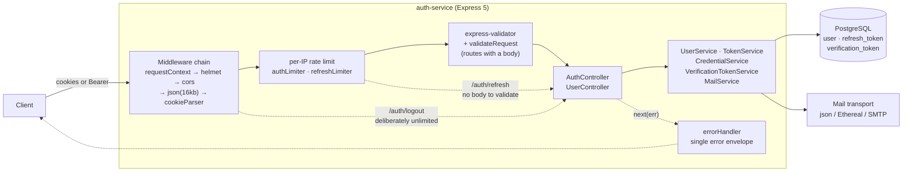
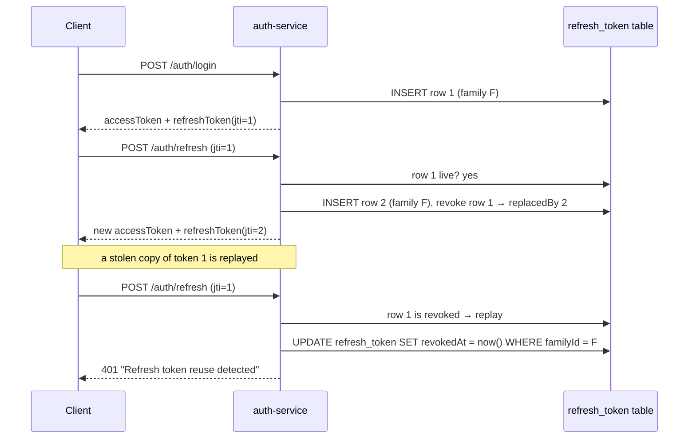

# auth-service

A standalone authentication service in TypeScript: registration and login, RS256
access tokens, rotating refresh tokens with reuse detection, password reset,
email verification and role-based access control, backed by PostgreSQL.

- API documentation (Swagger UI): `/api-docs` when the service is running
- Design rationale: [DECISIONS.md](./DECISIONS.md)

## Architecture



## How it works

`src/server.ts` opens the TypeORM connection and starts the HTTP server;
`src/app.ts` builds the Express application and nothing else, which is what lets
the integration tests drive the app with supertest without binding a port.
`src/container.ts` is the composition root: it constructs every service once and
injects the repositories, so the controllers and services can be unit tested with
plain fakes. A request passes through `requestContext` (correlation id and a
winston child logger), `helmet`, a CORS allowlist, a 16 kB JSON body cap and
`cookieParser`, then through a per-IP rate limiter and, if the route takes a
body, the express-validator schema for that route, before it reaches a
controller in `src/controllers/`.

Two routes take a different path and it is worth knowing which. `POST
/auth/refresh` has no body to validate — its only input is the `refreshToken`
cookie, whose signature the controller checks before using it — so it is
rate-limited but has no validator, and it uses `refreshLimiter` rather than
`authLimiter` so that machine-driven refresh traffic and human login traffic
cannot exhaust each other's budget. `POST /auth/logout` has neither: it revokes
rather than mints, an unusable cookie costs one signature check and no query,
and refusing a logout would leave alive the session the user asked to end.
Controllers hold only orchestration; the work lives in `src/services/`, and every
failure is thrown as an `http-errors` object and rendered by the single
`errorHandler` in `src/middlewares/errorHandler.ts`. Passwords are hashed with
bcrypt in `src/services/CredentialService.ts` (cost 10) and the plaintext is
never logged. Access tokens are signed RS256 with a key pair generated by
`npm run keys:generate`; refresh tokens are signed HS256 and, crucially, are
only accepted if the row they point at in the database is still live.

## Refresh tokens: rotation and reuse detection

A refresh token JWT carries the id of its own row in the `refresh_token` table as
the `jti`. Rows issued from a single login share a `familyId`. `POST /auth/refresh`
burns the presented row (`revokedAt` set, `replacedByTokenId` pointing at its
successor) and issues the next token in the same family. If a token that has
already been rotated is presented again, one of two things is true: an attacker
stole it, or the legitimate client is replaying an old copy. The service cannot
tell which, so it revokes the whole family and forces a fresh login.



Both branches are covered in `tests/users/refresh.spec.ts`, including the
assertion that a _different_ session of the same user is left untouched.

## API

All bodies and responses are JSON. Errors always use the same envelope:

```json
{
  "errors": [
    {
      "type": "BadRequestError",
      "msg": "...",
      "path": "",
      "location": "",
      "requestId": "..."
    }
  ]
}
```

Access and refresh tokens are set as `httpOnly`, `SameSite=Strict` cookies
(`secure` when `NODE_ENV=prod`). `/auth/self` and `/users` also accept
`Authorization: Bearer <accessToken>`.

| Method | Path                        | Auth                       | Request body                               | Success                                                                  | Failure                                                                         |
| ------ | --------------------------- | -------------------------- | ------------------------------------------ | ------------------------------------------------------------------------ | ------------------------------------------------------------------------------- |
| POST   | `/auth/register`            | none                       | `{ firstName, lastName, email, password }` | `201 { userId }` + cookies                                               | `400` validation / email taken, `429`                                           |
| POST   | `/auth/login`               | none                       | `{ email, password }`                      | `200 { id }` + cookies                                                   | `400` bad credentials, `403` unverified email (when gated), `423` locked, `429` |
| POST   | `/auth/refresh`             | `refreshToken` cookie      | none                                       | `200 { id }` + new cookies                                               | `401` missing / invalid / expired / replayed, `429`                             |
| POST   | `/auth/logout`              | `refreshToken` cookie      | none                                       | `200 { success: true }`                                                  | —                                                                               |
| GET    | `/auth/self`                | access token               | none                                       | `200 { id, firstName, lastName, email, role, emailVerified, createdAt }` | `401`                                                                           |
| POST   | `/auth/forgot-password`     | none                       | `{ email }`                                | `202 { success: true }`                                                  | `400` validation                                                                |
| POST   | `/auth/reset-password`      | none                       | `{ token, password }`                      | `200 { success: true }`                                                  | `400` invalid / used / expired                                                  |
| POST   | `/auth/verify-email`        | none                       | `{ token }`                                | `200 { success: true }`                                                  | `400` invalid / used / expired, `429`                                           |
| POST   | `/auth/resend-verification` | none                       | `{ email }`                                | `202 { success: true }`                                                  | `400` validation                                                                |
| GET    | `/users`                    | access token, role `admin` | none                                       | `200 { users: [...] }`                                                   | `401`, `403`                                                                    |
| GET    | `/health`                   | none                       | none                                       | `200 { status: "ok", uptimeSeconds }`                                    | —                                                                               |
| GET    | `/ready`                    | none                       | none                                       | `200 { status: "ready", database: "up" }`                                | `503` database unreachable                                                      |
| GET    | `/api-docs`                 | none                       | none                                       | Swagger UI                                                               | —                                                                               |

`/auth/forgot-password` and `/auth/resend-verification` answer `202` whether or
not the address exists, so they cannot be used to enumerate accounts.

Every response carries an `x-request-id` header. Supply your own and it is
echoed back and used in the logs for that request.

## Setup

### Prerequisites

- Node.js 24 (`.nvmrc`; verified on Node 24.16.0 / npm 11.13.0)
- PostgreSQL 14 or newer, or Docker

### With Docker Compose

```bash
docker compose up --build
# API   http://localhost:5501
# Docs  http://localhost:5501/api-docs
```

Compose starts PostgreSQL and waits for its healthcheck. The image's `CMD` then
generates the key pair on first boot, runs `npm run migration:run` to create the
schema, and only then starts the service with nodemon against a bind mount. A
failed migration stops the container rather than starting the service against a
half-built schema.

### Without Docker

```bash
npm install
npm run keys:generate          # writes certs/private.pem and certs/public.pem (gitignored)
cp .env.example .env.dev       # then fill in the values
createdb authservice_dev       # or any empty database matching DB_NAME
npm run migration:run          # creates the schema
npm run dev                    # http://localhost:5501
```

The database has to exist and be migrated before the service starts:
`synchronize` is on only under `NODE_ENV=test`, so nothing builds the schema
implicitly.

### Database migrations

The schema lives in `src/migrations/`, registered in `src/migrations/index.ts`.

| Script                                                | What it does                                                                |
| ----------------------------------------------------- | --------------------------------------------------------------------------- |
| `npm run migration:run`                               | Applies every pending migration. Idempotent — a second run is a no-op.      |
| `npm run migration:revert`                            | Reverts the last applied migration.                                         |
| `npm run migration:show`                              | Lists migrations and whether each is applied.                               |
| `npm run migration:generate -- src/migrations/<Name>` | Diffs the entities against the current database and writes a new migration. |
| `npm run migration:run:built`                         | The same as `migration:run`, against compiled `build/` output.              |
| `npm run migration:revert:built`                      | The same as `migration:revert`, against compiled `build/` output.           |

The first four run the TypeScript sources through `ts-node`'s ESM loader —
`tsx` cannot be used here because it does not emit the decorator metadata
TypeORM reads the column types from. The `:built` pair run plain `node` against
`build/`, which is the path a deployment takes: it needs no dev dependencies.

After generating a migration, add its class to the array in
`src/migrations/index.ts`. `tests/db/migrations.spec.ts` fails if you forget.

Adding a column to an entity without writing a migration is caught by the same
suite: it runs the migrations on an empty database and asserts TypeORM's schema
builder has no remaining DDL to apply, so the migrations and the entities cannot
drift apart silently.

### Configuration

Configuration is read from `.env.$NODE_ENV` — `.env.dev`, `.env.test`,
`.env.prod` — via `src/config/index.ts`. Real environment variables always take
precedence over the file, which is why the Compose and CI setups do not ship
one. `DB_HOST`, `DB_PORT`, `DB_USERNAME`, `DB_PASSWORD`, `DB_NAME` and
`REFRESH_TOKEN_SECRET` are mandatory: the process refuses to start without them.
Every variable is listed and commented in [.env.example](./.env.example).

### Email

`MAIL_TRANSPORT` selects how password-reset and verification mail is delivered.
All three options are free:

- `json` (default) — nothing is sent; the message is logged and kept in an
  in-memory outbox that the tests assert against.
- `ethereal` — [Ethereal](https://ethereal.email) creates a throwaway mailbox on
  demand with no signup, and the log line for each message contains a preview
  URL. Nothing is delivered to real inboxes.
- `smtp` — any SMTP server, via `SMTP_HOST`, `SMTP_PORT`, `SMTP_SECURE`,
  `SMTP_USER`, `SMTP_PASSWORD`.

The `json` and `ethereal` transports have both been run end to end from this
repository; `smtp` has not. See "Notes and limitations".

## Running the tests

The suite is mostly integration tests driven by supertest, so **it needs a real
PostgreSQL**. It drops and re-creates the schema between test cases, so point it
at a throwaway database.

```bash
cp .env.example .env.test      # DB_NAME should be a scratch database
npm run keys:generate
npm run test:ci                # single run, CI-safe
npm run test:watch             # watch mode for local work
```

`npm test` and `npm run test:ci` both run once and exit. `npm run test:watch` is
the only watching script — the previous `test` script passed `--watch` and hung
forever in CI.

Full local verification:

```bash
npm run lint:check
npm run typecheck
npm run build
npm run test:ci
```

## Project layout

```
src/
  app.ts               Express app assembly (no listen call)
  server.ts            connection, listen, graceful shutdown
  container.ts         composition root
  config/              env loading + validation, winston, TypeORM data source
  controllers/         AuthController, UserController
  services/            UserService, TokenService, CredentialService,
                       VerificationTokenService, MailService
  entity/              User, RefreshToken, VerificationToken
  migrations/          generated schema migrations + the explicit register
  middlewares/         requestContext, errorHandler, validateRequest,
                       authenticate, requireRole, rateLimiters
  validators/          express-validator schemas per route
  routes/              auth, users, health
  docs/openapi.ts      hand-written OpenAPI document
tests/
  users/               register, login, refresh, rbac, password-reset, rate-limit
  ops/                 health, readiness, headers, docs, 404
  db/                  migrations up, down, and parity with the entities
  unit/                UserService with fake repositories
```

## Tech stack

Runtime and framework: Node.js 24, TypeScript 5.9, Express 5.
Data: PostgreSQL via TypeORM 0.3 and `pg`.
Auth: `jsonwebtoken` (RS256 access, HS256 refresh), `bcrypt`.
Hardening: `helmet`, `cors`, `express-rate-limit`, `express-validator`,
`cookie-parser`, `http-errors`.
Operations: `winston`, `nodemailer`, `swagger-ui-express`, `dotenv`.
Tooling: Jest 30 with ts-jest, supertest, ESLint 9 (flat config), Prettier,
husky and lint-staged.

## Notes and limitations

Things a reader should know before judging this code:

- **The Docker image is a development image.** `docker/dev/Dockerfile` runs the
  TypeScript sources under nodemon with the dev dependencies installed. There is
  no production Dockerfile; a deployment would run `npm run migration:run:built`
  and `npm start` against the compiled output.
- **Rate limiting is in-process.** `express-rate-limit` uses its default memory
  store, so the limit is per instance. More than one replica needs a shared
  store (Redis) for the limit to mean anything.
- **Email verification does not block login by default.** Set
  `REQUIRE_EMAIL_VERIFICATION=true` to enforce it; both behaviours are tested.
- **The SMTP mail transport has never been run.** `json` and `ethereal` were
  both exercised end to end (Ethereal returned a working preview URL); the
  `smtp` branch is implemented and typechecked but untested against a real
  server.
- **Docker Compose and the CI workflow have not been executed as such.** Docker
  is not available in the environment this was built in, and the workflow has
  not run on GitHub Actions. Every command either of them runs — `npm ci`,
  `keys:generate`, `lint:check`, `format:check`, `typecheck`, `build`,
  `migration:run`, `migration:show`, `migration:revert`, `test:ci` — was run
  locally against a real PostgreSQL 18.4 and passes, and the container's exact
  start-up line (`sh -c "[ -f certs/private.pem ] || npm run keys:generate; npm
run migration:run && npm run dev"`) was run against an empty database and
  brought the service up serving requests. What has not been exercised is the
  orchestration: image build, service healthcheck ordering, container
  networking.
- **No refresh-token cleanup job.** Revoked and expired rows accumulate in
  `refresh_token`; a periodic delete is needed before this runs for long.
- **Logout revokes the whole family, not every session.** There is no
  "sign out everywhere" endpoint; a password reset is currently the only thing
  that revokes all of a user's tokens.
- **`npm audit` is clean** (`found 0 vulnerabilities`, npm 11.13.0). It
  previously reported 19 advisories — 1 critical, 10 high, 6 moderate, 2 low.
  Eighteen were transitive and resolved inside the existing semver ranges by
  `npm audit fix`; the last one was TypeORM itself (GHSA-9ggv-8w38-r7pm,
  GHSA-2rp8-mm9q-fp49, both `<=0.3.30`), fixed by moving the direct dependency
  from `0.3.27` to `^0.3.31`. The full verification suite was re-run after each
  step. See DECISIONS.md decision 12.

## License

MIT — see [LICENSE](./LICENSE).
